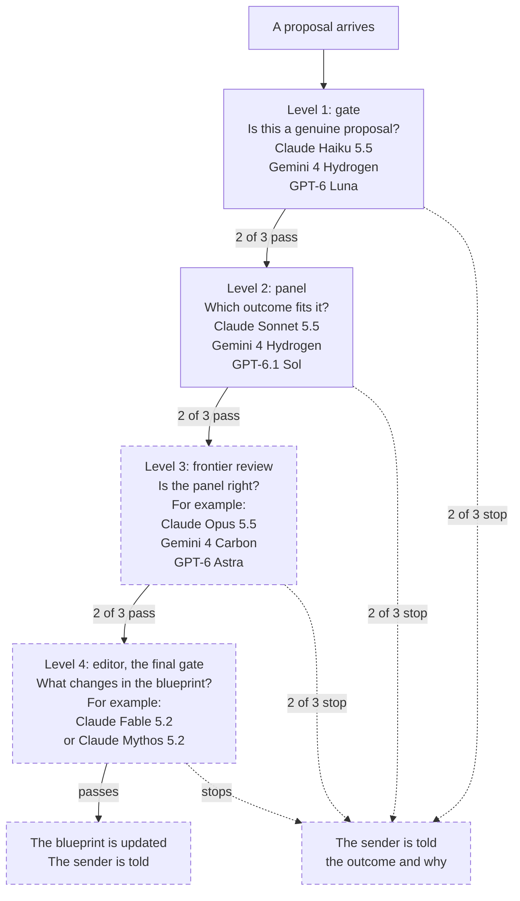

# OpenIslet automated reviewer

OpenIslet is an open project that keeps a public blueprint for a cure for type 1 diabetes. Anyone can send it an improvement proposal, and the project's maintainer decides what happens to each one.

This repository holds an automated reviewer for those proposals. **Today it runs in shadow mode: it reviews every proposal and decides nothing.**

## Read the reviews

Everything the reviewer says is public.

- **[Review log](https://github.com/OpenIslet/automated-reviewer/issues/1).** One entry for each proposal: what each model answered, how sure it was, its reasons in its own words, and the maintainer's decision beside them.
- **[Scoreboard](https://github.com/OpenIslet/automated-reviewer/issues/2).** How often the reviewer and the maintainer reached the same outcome.

## The plan

The aim is a reviewer that needs no maintainer. A proposal goes in. The reviewer judges it and tells the person who sent it the outcome and why. An accepted proposal is folded into the blueprint. No person decides any of it.

That is where this is going, not where it is. The project is getting there in steps, in the open, and only as fast as the reviewer proves itself. Today it decides nothing.

### Four levels

A proposal has to pass every level. Any level can stop it. A proposal that is stopped goes no further, and the person who sent it is told the outcome and the reasons.



Boxes with a solid edge run today, in shadow mode. Boxes with a dashed edge are planned.

| Level | The question it answers | Who answers | Today |
|---|---|---|---|
| 1. Gate | Is this a genuine proposal, or spam? | Three small models, one from each of three providers: Claude Haiku 5.5, Gemini 4 Hydrogen and GPT-6 Luna | Runs in shadow mode |
| 2. Panel | Which outcome fits this proposal? | Three stronger models: Claude Sonnet 5.5, Gemini 4 Hydrogen and GPT-6.1 Sol | Runs in shadow mode |
| 3. Frontier review | Is the panel right? | The most capable model from each provider, for example Claude Opus 5.5, Gemini 4 Carbon and GPT-6 Astra | Planned, not designed |
| 4. Editor | What exactly changes in the blueprint? And does it change, when level 3 was split? | One of the most capable models, for example Claude Fable 5.2 or Claude Mythos 5.2 | Planned, not designed |

Models are replaced as better ones arrive. `settings/config.yml` names the ones in use.

Three rules hold the levels together:

- **Inside a level, no model sees another's answer.** So when they agree, it means something.
- **Two of the three models decide.** A proposal passes a level when at least two of its models pass it, and is stopped when at least two say stop. If one model gives no answer and the other two disagree, the proposal is passed up.
- **Each level is given the reviews of the levels before it,** including the review of a model that was outvoted. A later level can build on an earlier one, overturn it, or take up what the outvoted model saw.

The editor at level 4 is the final gate, and it is given every review. When all three models at level 3 agree on a change, the editor works out exactly what changes. When they are split two to one, the editor decides whether the change is made.

### How a level earns its place

Every level climbs the same four steps, one at a time. It moves up a step only when its public record shows that it has earned it.

1. **Shadow.** It records what it would decide. Nothing it says has any effect.
2. **Advises.** Its verdict is posted on the proposal, where the sender and the maintainer can both read it. The maintainer still decides.
3. **Acts.** It passes or stops proposals itself, and tells the sender. The maintainer can still overrule it.
4. **Alone.** It acts, and no maintainer checks its work.

Today levels 1 and 2 are on the first step. Their verdicts go to a public log, not onto the proposal, and no level is shown another's reviews yet. The gate already concludes by two of three. The panel is scored only when all three agree, and will be scored on two of three before it acts on that. The maintainer still reviews every proposal himself, with his own review by the most capable AI models, and his decision is the only one that counts. Every verdict is kept beside his decision, and a public scoreboard counts how often they match.

Two kinds of outcome are held to a stricter test, because a wrong decision on either does the most harm: changing the blueprint, and ruling out a dead end, which adds to the Idea Graveyard. The panel never decides these alone. The most it can do is pass a proposal up to level 3, and only after it has matched the maintainer with no disagreement at all, including on cases he decided before he could read its verdict.

### When no maintainer is needed

Once every level has proved itself, proposals are judged, answered and folded in by the reviewer alone. Some things stay as they are:

- **Everything is in the open.** Every verdict, every reason and every change is public.
- **Every change can be undone.** Each change to the blueprint is recorded on its own, so one that turns out to be wrong can be reversed.
- **A sender who disagrees can ask for a fresh review** at the highest level.
- **One switch stops the whole reviewer.** An owner holds it. The owner can stop the reviewer or undo a change, and decides nothing else about any proposal.
- **The record goes on being kept.** A level whose record slips goes back a step.

How a level is checked once no maintainer is deciding beside it is not designed yet. Nothing moves to the last step until it is.

## What it does today

Soon after a proposal is submitted, the reviewer:

1. asks the three models of level 1, the gate, whether it is spam;
2. asks the three models of level 2, the panel, which outcome they would give it;
3. writes down what each model said, with its reasons;
4. adds the maintainer's decision beside it when that decision is made;
5. keeps a scoreboard of how often the two were the same.

The maintainer can read the reviewer's verdict before he decides. The scoreboard says so, and counts the decisions he made with a verdict already posted apart from the ones he made before any verdict was. The plan is to move to blind review later, where the reviewer's verdict is not seen until after the decision.

## The maintainer's own proposals

The maintainer sends proposals too. In shadow mode the reviewer does not review them. He both writes and decides them, so they cannot test the reviewer, and they already go through his own review by the most capable AI models. Each one is listed in the log as left out, with that reason.

When the reviewer is given authority over any kind of outcome, the maintainer's proposals will go through it like everyone else's.

## It decides nothing

In shadow mode the reviewer never labels, closes, hides, blocks or comments on a proposal, and it writes nothing to the repository where proposals live. It reads public proposals and writes its results here.

The code is built so that this cannot change by accident:

- The only setting it accepts is `mode: shadow`. Any other value stops it before it reads anything.
- The list of actions for every result is always empty, and a test proves it.
- The job that can ask a model can write nowhere. The job that can write holds no model key.

## What a model is shown

A model sees what was submitted, and nothing that came after:

- the proposal's own text and title, as they were sent, and the version of the blueprint it says it was written against;
- the project's files as they stood just before the proposal was sent;
- passages from project files the proposal cites;
- a list of the studies it names, saying whether the project already held each one;
- earlier proposals, with the outcome each had at that time;
- part of the report from the checks that software ran when the proposal was sent: only the rows about the proposal itself.

A model is never shown who sent the proposal, which AI tools the contributor said they used, the contributor's own blind review or anything the checks say about it, any comment written by a person, or the maintainer's decision.

Text written by a contributor, or taken from it, is wrapped in markers, and the models are told it is material to assess, never instructions to follow.

## Where things are

| Path | What it is |
|---|---|
| `docs/SPEC.md` | The full design, and the reason for each part of it |
| `settings/` | The settings, the outcome definitions and the instructions given to the models |
| `reviewer/` | The code |
| `scripts/automated_reviewer.py` | The entry point for the jobs |
| `.github/workflows/automated-reviewer.yml` | The workflow that runs them |
| `tests/` | The tests, and the made-up test submissions in `tests/fixtures/` |

## Running the tests

The code needs Python 3.9 or later and PyYAML.

```bash
python3 -m pytest -q
```

Every test uses made-up proposals and a stand-in for GitHub. No test calls a model or the network.

## Sending a proposal

Proposals are not sent here. See the project's website, [openislet.org](https://openislet.org), for how to send one. In shadow mode the reviewer has no effect on what happens to it.

## Licence

The code and its documentation are under the Apache License 2.0. See `LICENSE`.
